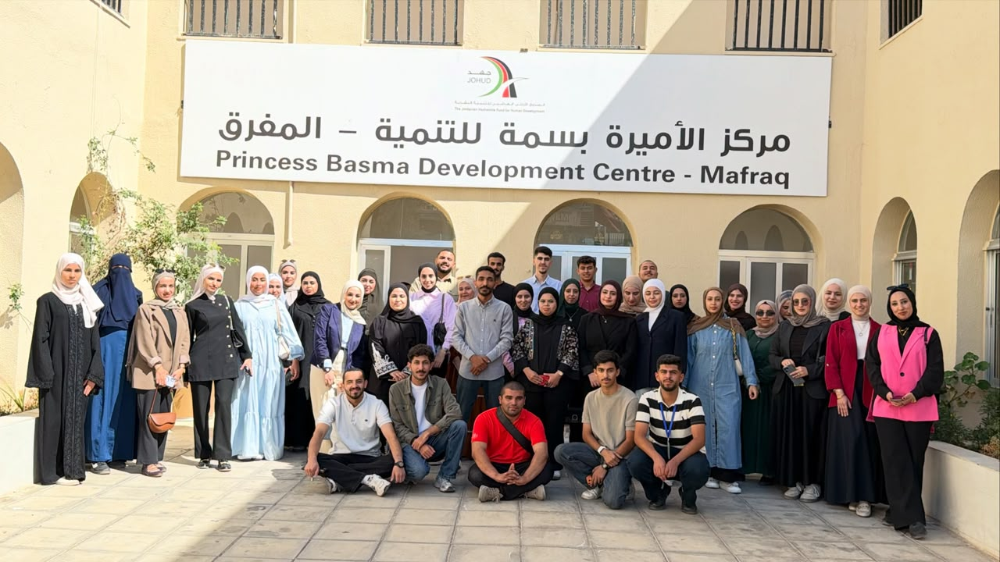

# RAQEEM — Unslop UI Audit

## A. Slop inventory (قبل التعديل)

| الأهمية | الدليل من الشيفرة الأصلية | التقييم |
|---|---|---|
| **High** | `.apple-showcase`, `.showcase-device`, `.showcase-progress` | جهاز اصطناعي وواجهة داخل واجهة؛ يصرف الانتباه عن المجتمع الحقيقي. |
| **High** | `.logo-orbit`, `.hero-orb`, `.fx-marquee` | حلقات وأشكال زخرفية متكررة لا تشرح نشاطًا أو نتيجة. |
| **High** | `.track-list { grid-template-columns: repeat(2,...) }` مع أربع بطاقات متشابهة | كل مجال يظهر بالوزن والحجم نفسه، دون تسلسل قراءة واضح. |
| **High** | `.footer-meta` نص واحد صغير، دون `<a>` للبريد والاجتماعي | لا توجد منطقة تواصل واضحة أو روابط اجتماعية فعلية. |
| **High** | `src="team.jpeg"` في HTML الأصلي، والصورة موجودة في `assets/gallery/team.jpeg` | مسار غير صحيح قبل اعتماد مسارات المعرض. |
| **Medium** | `#impact`, `.metrics` و `.academy-stats` | تكرار أرقام الأثر في ثلاثة مواضع بلا اختلاف وظيفي واضح. |
| **Medium** | أزرار مستديرة وبطاقات كثيرة وأيقونات تُستخدم بلا سبب | لغة UI عامة أكثر من كونها هوية مبادرة بعينها. |
| **Medium** | تصميم `schedule.html` يستخدم `.ambient-glow`, `.holo-card`, لونًا برتقاليًا ودرجات نيون | صفحة عامة لا تنتمي بصريًا إلى الصفحة الرئيسية. |
| **Medium** | ملف CSS قديم يحمل عدة ثيمات متضاربة | تعدد الطبقات يصعّب الصيانة ويؤدي إلى نتائج غير متوقعة. |

**لم يكن الخط العربي بحد ذاته مشكلة**: الاختيارات السابقة Tajawal وIBM Plex Sans Arabic كانت مناسبة، لذلك لم نغيّرها لإحداث فرق شكلي فقط.

## B. What to keep

1. الشعار الأصلي ودرجات الأزرق والسماوي المستمدة منه.
2. العربية وRTL أولًا، والتوجه الشبابي المباشر دون مبالغة دعائية.
3. الأرقام المحدثة: 3,417 / 161 / 19,326 — بلا عدّادات مشوّشة.
4. معرض الصور الأربع، ومسار الطلب عبر واتساب أو البريد، ووظائف منصة المحتوى.
5. قابلية السحب والإغلاق المباشر لقائمة الهاتف؛ دون ارتداد بصري غير ضروري.

## C. Unslop direction

**اسم التوجه:** «مجتمع رقمي معاصر».

**الحركة المميزة الواحدة:** صورة تجمع حقيقية بحجم تحريري كبير في الواجهة، مع تعليق بسيط يعزز شعور المجتمع. بقية الموقع هادئ: عناوين قوية، قواعد تنظيمية ذات وظيفة، وقائمة مجال بخطوط فاصلة؛ لا أحزمة GIF ولا أجهزة وهمية.

**الألوان:**

| الوظيفة | اللون |
|---|---|
| الخلفية | `#F7F9FA` |
| الأسطح | `#FFFFFF` |
| سطح ثانوي | `#EDF3F6` |
| النص الرئيسي | `#10263D` |
| النص الثانوي | `#516474` |
| علامة التركيز / الروابط | `#16799F` |
| أزرار أساسية | `#116181` |
| درجات سماوية محددة | `#7AD0DD` |
| حدود | `#D7E1E7` |
| مساحة أثر وفوتر | `#112840` / `#102C43` |

**الخط:** Tajawal للعناوين، IBM Plex Sans Arabic للنصوص والواجهات. لا Inter أو Roboto أو Arial أو system-ui بوصفها صوت الهوية. يُسمح بخط احتياطي تقني عند تعذّر تحميل خط الويب فقط.

**ما يجب عدم إعادته:** خلفيات متوهجة، gradient بنفسجي، جهاز لابتوب تخيّلي، بطاقات موحدة لكل فقرة، عدّاد متحرك لكل رقم، hover تكبير الصور، فواصل رقمية 01/02/03 لا تشرح تسلسلًا، أو تأثيرات مستمرة دون تفاعل.

## D. Rewrite plan — ما أُنجز بالترتيب

1. **Must-fix:** إصلاح مسارات الصور، فوتر واضح وروابط اجتماعية، هيكل متنقل، إزالة العنصر الاصطناعي في الـ hero.
2. **High-impact:** إيقاع نصي أقوى، ترتيب المجالات كصفوف مفهومة، قسم أثر واحد، مجموعة صور غير متماثلة، تحسين المنصة.
3. **Craft:** حالة القائمة والسحب وتقليل الحركة، حالة خطأ لتحميل الدورات، تقليل تبعيات الستايل القديمة، تحسين alt وfocus، بطاقة تواصل داخل صفحة الدورات.

## E. Concrete edits (منفّذة في الملفات)

**الشريط القديم:**

```html
<div class="apple-showcase"> ... <div class="showcase-device"> ... </div></div>
```

**الجديد:**

```html
<div class="hero-visual">
  
  <div class="hero-image-foot"><span>مجتمع ينمو بالمعرفة</span><strong>RAQEEM / JORDAN</strong></div>
</div>
```

**بطاقات مسارات متشابهة:** أعيدت إلى `track-list` من صفوف مرئية بسيطة، تميز العنوان والوصف والتحويل إلى المنصة، بلا قوالب متكررة محشوة بأيقونات.

**التواصل:**

```html
<a class="footer-email" href="mailto:raqeemimpact@gmail.com">...</a>
<a href="https://www.instagram.com/raqeem_jo/?hl=en" target="_blank" rel="noopener noreferrer">Instagram</a>
<a href="https://www.linkedin.com/company/raqee/" target="_blank" rel="noopener noreferrer">LinkedIn</a>
```

**الاستجابة:** في `assets/raqeem.css` تتحوّل الواجهة من عمودين إلى عمود على الهاتف، وتتوزع الصور بحسب أحجامها، ويختصر نموذج الانضمام من عمودين إلى عمود؛ حجم الخط يبقى مقروءًا وتبقى الأزرار قابلة للمس.

**المنصة:** ما زالت تستخدم `assets/site.js` لكن بواجهة جديدة أخف. حُذف فيديو الخلفية غير الضروري من الصفحة، مع الإبقاء على البحث والترتيب والتصنيف وتبديل العرض ونوافذ التشغيل.

**حدود النسخة:** تبدو عناصر YouTube فقط بعد نجاح اتصال الخدمة الخارجية؛ لا يتم اختلاق فيديوهات. صفحة الإدارة الداخلية لم تُعد بناؤها حفاظًا على تدفق بياناتها.
